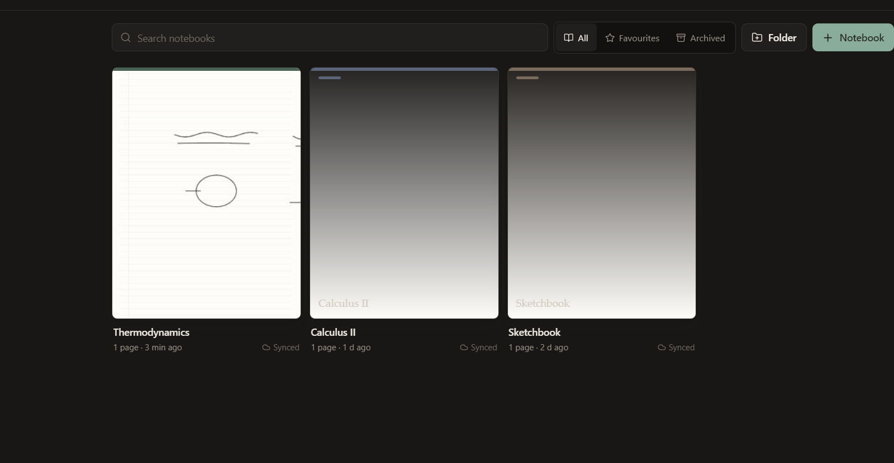
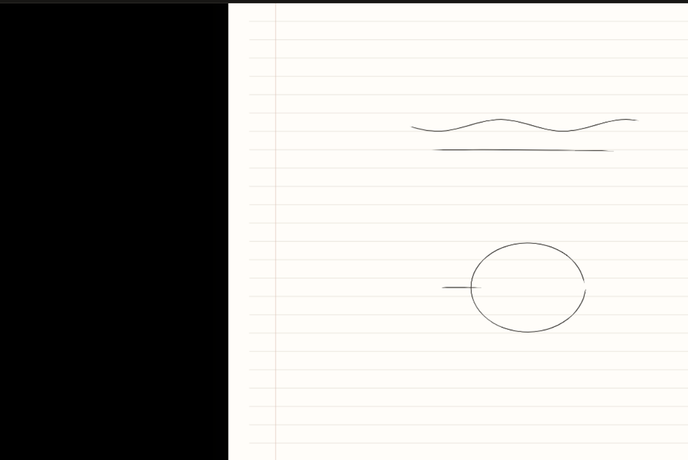
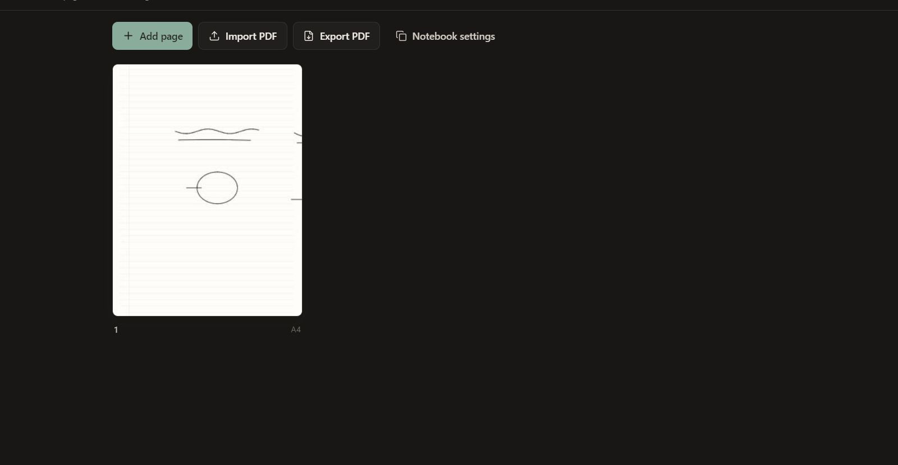

<div align="center">

# NŌTA

**Handwriting notebooks for iPad, with the notes in your own house.**

No account, no subscription, no cloud. The iPad app is served by a small server
on your Windows laptop and syncs with it over your own network.



</div>

| A page | Inside a notebook |
| --- | --- |
|  |  |

## What it is

* **Pen-first canvas** — pressure, tilt, palm rejection while the pencil is
  down, partial erasing, lasso, shapes, text, images.
* **Nothing leaves your machines** — every stroke lives in IndexedDB on the iPad
  and in SQLite on the laptop. The server listens on your network only and
  refuses peers that are not private.
* **Works with the network off** — installable PWA, full offline shell; the
  library and the ink stay put.
* **Sync that survives** — incremental, bidirectional, tombstones, conflicts
  kept rather than overwritten, one revocable token per device.
* **Schoolwork** — equations in LaTeX, function graphs, tables, a scientific
  calculator, a unit converter, PDF import, handwriting over the original page.
* **Backups** — checksummed ZIPs on the iPad, rotating archives on Windows.

## Run it

```text
1. Double-click run.bat              installs and starts the Windows server
2. It opens http://localhost:8080/   the app, on this laptop
3. On the iPad, open /setup once, install the profile, then press
   "Connect to my laptop" and Allow on the laptop
```

The iPad trusts one locally generated certificate so Safari allows an HTTPS API.
Nothing is installed on the laptop itself: it runs on plain loopback HTTP.

## Repository

```text
frontend/   React + TypeScript PWA, drawing engine, sync client
backend/    FastAPI + SQLite server, pairing, backups
scripts/    PowerShell install / start / backup / firewall helpers
docs/       Architecture, iPad setup, sync protocol, testing
```

## Built with heavy AI assistance

Most of this codebase was written with AI coding agents working under my
direction — architecture, drawing engine, sync protocol, tests and docs. The
product decisions, the hardware checks and everything that ships were reviewed
and validated by me, but if you are reading this to judge hand-written
engineering: this is not that. It is a large, deliberately tested project built
at AI speed.

## Checks

* `npm run typecheck` — strict TypeScript
* `npm test` — 216 unit tests (drawing, sync, pairing)
* `pytest` — 147 backend tests (auth, push/pull, conflicts, tombstones, backups, pairing)

What needs real hardware stays on the manual list: Pencil pressure and tilt,
palm rejection, sustained frame rate, Safari PWA installation, certificate
trust.

Personal use. No analytics, no telemetry, no third-party requests at runtime.
